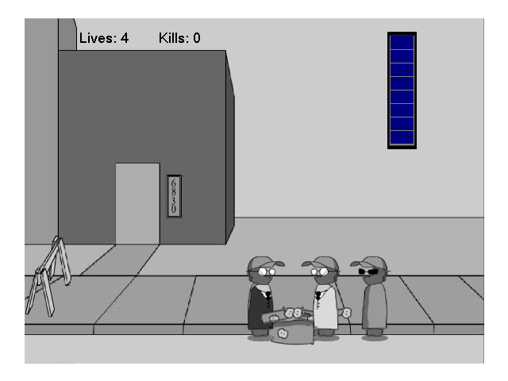
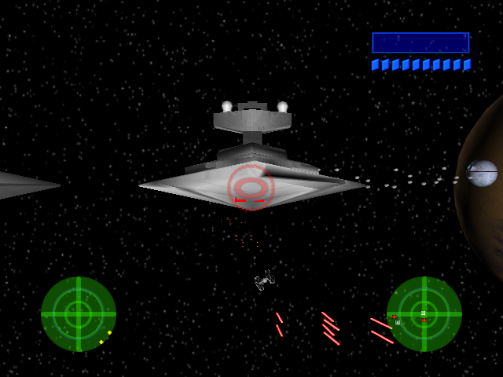
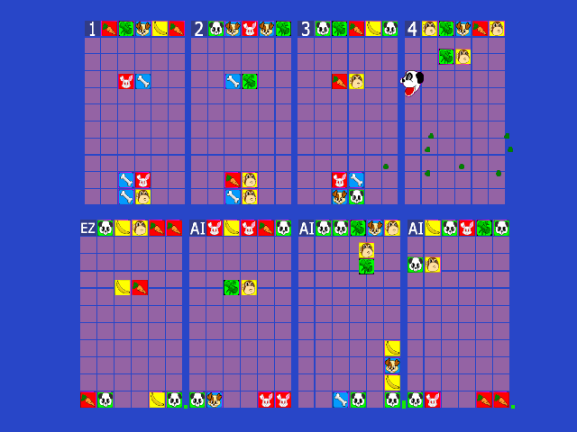

# AfterShock — Xbox homebrew decompilations

Readable C++ reconstructions of the original Xbox homebrew games by
**AfterShock** (SHiZNO and friends, 2005). Each game builds with the original
toolchain (Xbox XDK 5558, MSVC 7.1) into a `default.xbe` that plays like the
original, quirks included. You need your own copy of each game for its
`media/` folder.

| Game | Folder | Functions in `src/` | Verified |
|------|--------|---------------------|----------|
| [AfterShock Pool SX](games/pool/README.md) | `games/pool` | 109 of 109 (~158 KB), 100% | Side by side in an emulator, frame by frame |
| [Madness Interactive SX](games/madness/README.md) | `games/madness` | 93 of 93 (~91 KB), 100% | Screenshots in xemu, pixel-identical to the original |
| [Star Wars: A New Hope for Homebrew](games/starwars/README.md) | `games/starwars` | 238 of 238 (~97 KB), 100% | Frame by frame against the original (`tools/difftest.py`), every scenario bit-identical; `funcdiff.py` |
| [Baku Baku X2](games/bakubaku2/README.md) | `games/bakubaku2` | 119 of 119 (~38 KB), 100% | Frame by frame against the original (`tools/difftest.py`): menus, 8-player matches, fuzzed input; `funcdiff.py` 77 of 118 identical |

<p align="center">
  
  
</p>
<p align="center">
  
  
</p>

The games were written by the same people with the same engine code (the
gamepad, font, music player, sound and scrolling credits), so they share one
set of tools and one build. Each game keeps its own copy of that engine code,
as it was built.

## Goals

1. **Behave exactly like the originals.** Every function of each game is
   reconstructed, named and commented; bugs and oddities are kept and marked
   as quirks, not fixed.
2. **A base for mods and additions.** Plain C++ in the XDK's style, with every
   class layout checked against the original at compile time.
3. **Eventually: byte-for-byte matching**, one function at a time. The
   rebuilds aren't byte-identical yet.

## Building

You need the **Xbox XDK 5558**, which isn't included. `./xdk` should point at
it: the folder with `xbox/bin/vc71/CL.exe`, `xbox/include` and `xbox/lib` (or
pass `XDK=<path>` to make). Put each game's original release in
`games/<game>/original/` (`default.xbe` and `media/`).

### Linux (and WSL)

The XDK's tools run under Wine:

```
sudo apt install make wine python3 gcc
ln -s /path/to/xdk5558 xdk
make -j4                 # every game
make bakubaku2           # one game: pool, madness, starwars or bakubaku2
cd games/<game> && make  # the same, from the game's folder
make info                # (in a game's folder) the toolchain and paths it uses
```

Each game's result is `games/<game>/build/xbox/default.xbe`. To get a disc
image with the original's `media/` next to it, run `make xiso` in the game's
folder (or `make madness TARGET=xiso` from the top). `make original-xiso`
makes one of the untouched original, to compare against. The disc tool
(extract-xiso) is built from `thirdparty/`.

### Windows

*Not tested yet. Reports welcome.*

The XDK's tools run natively; the Makefiles only need a Unix-style shell for
`mkdir`, `grep`, `cp` and `rm`, which Git for Windows provides.

1. Install [Git for Windows](https://gitforwindows.org) (use its **Git Bash**),
   GNU make (`winget install ezwinports.make`, or `pacman -S make` in
   MSYS2) and [Python 3](https://www.python.org) with "Add to PATH" ticked.
2. Link the XDK into the repository without spaces in the path, since make
   can't handle them. From a Command Prompt in the repository folder:
   ```
   mklink /J xdk "C:\Program Files\Microsoft Xbox SDK"
   ```
   (or copy the XDK somewhere like `C:\xdk5558` and pass `XDK=C:/xdk5558`).
3. From Git Bash in the repository folder, for each game you want
   (`pool`, `madness`, `starwars`, `bakubaku2`):
   ```
   cd games/<game>
   make info
   make
   ```

If the compiler can't find `mspdb71.dll`, copy it next to `CL.exe`. If make
tries to run `wine`, your shell isn't reporting `OS=Windows_NT`; add `WINE=`
to the command.

### xemu

Madness Interactive SX draws nothing but its background colors in
[xemu](https://xemu.app), the original included (see its README). `make
XEMU=1 xiso` builds a version that works around it into `build/xemu/`, and
`make XEMU=1 original-xiso` patches the original the same way. The default
build never has these workarounds.

## Layout

* `games/<game>/` — one game:
  * `src/` — the game. Every function carries its original address
    (`// 0x00012400`) and every member its offset (`// +0x1C`).
  * `symbols/` — the names database: `names.txt` (by hand), `xdklib.txt`
    (XDK 5558 library code matched byte for byte by `tools/libmatch.py`),
    `xdk.txt`, `consts.txt` (float constants), `types.h`.
  * `game.ini` — what the shared tools need to know about the game (where
    its code is, its Ghidra project); `Makefile` — its certificate.
  * `tools/` — tools only this game needs.
  * `original/` — your copy of the game (not in the repository).
* `tools/` — shared by every game. They work on the game whose folder they're
  run from (or `GAME=<folder>`):
  * `xbox.mk` — the build.
  * `analyze.sh`, `apply.sh` — headless Ghidra: import the original and
    export functions and decompiler output to `build/export`, then re-apply
    names and types after editing `symbols/` or `src/*.h`.
  * `show.py` — decompiler output with constants and D3D states resolved;
    `disasm.py`, `xrefs.py`, `callgraph.py`, `globalmap.py`.
  * `progress.py` — how much of the game is named and in `src/`.
  * `gen_src_structs.py` — Ghidra structs and compile-time layout checks
    from `src/*.h`; `gen_consts.py`, `libmatch.py`, `gen_xdk_symbols.py`.
  * `crossmatch.py <other game>` — functions this game shares with another,
    by instruction shape: where to start on a new game.
  * `funcdiff.py [-v] [function ...]` — each function of the rebuild against
    the original's: the calls, constants (floats and strings by value),
    compares (signed or unsigned, by threshold) and struct offsets only one
    side has. Codegen differences remain; a constant, compare or call that
    differs is usually a mistake in `src/`.
  * `xemu_drive.py <xemu.toml> "<script>" <outdir>` — boots xemu with a
    virtual (uinput) gamepad and plays a script of waits, button presses,
    stick pushes, screenshots (`shot:`), memory dumps (`mem:`) and whole-RAM
    snapshots (`ram:`). Use a private xemu config whose `port1` is the pad
    GUID the tool prints.
* `thirdparty/extract-xiso` — the disc image tool (BSD license).

## Adding a game

1. Make `games/<name>/` with the release in `original/`, a `game.ini` (copy
   one; `app_ranges` is the game's own code in `.text`, which `xbe.py` and
   `libmatch.py` help find) and a `Makefile` with its certificate.
2. Match the XDK libraries (`libmatch.py`), run `analyze.sh`, then
   `crossmatch.py pool` and `crossmatch.py madness` to name the engine code
   the games share.
3. Name, type and reconstruct the rest; `progress.py` keeps count.

## Legal

This is a reconstruction for study, preservation and modding. It doesn't
include the original XBEs, their media or any part of the XDK. You need your
own copy of each game.
