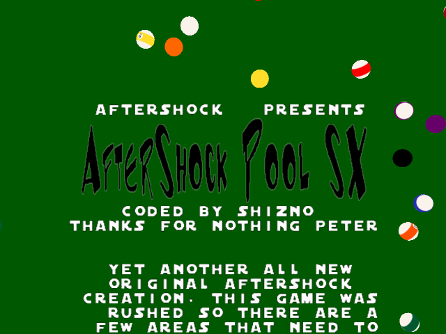
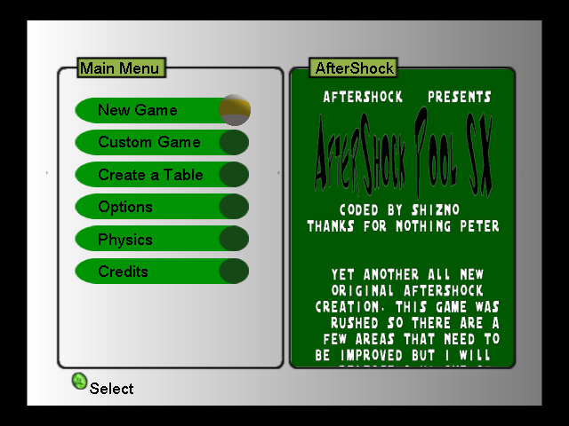
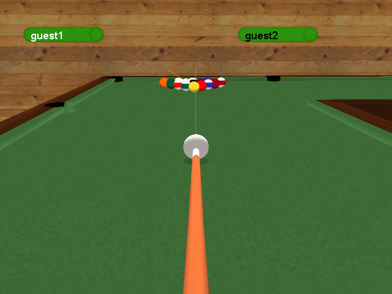
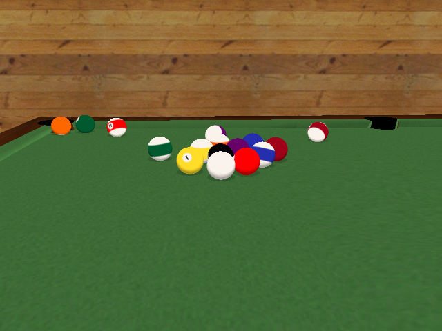
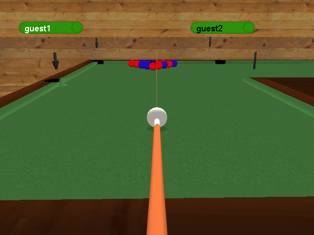
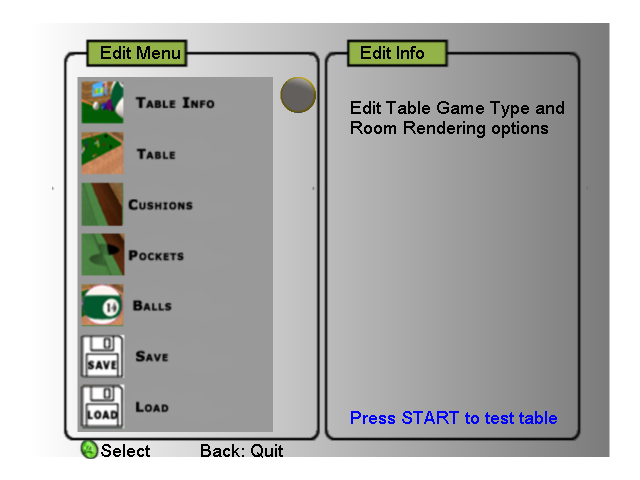

# AfterShock Pool SX — decompilation

A readable C++ reconstruction of **AfterShock Pool SX** (SHiZNO / AfterShock,
2005), an original Xbox homebrew pool game: 8 Ball, 9 Ball, Cut Throat,
Red vs Blue, Mini-Golf-Pool, a bar room to play in and a built-in table
editor.

**It builds and runs.** The source compiles with the original toolchain
(Xbox XDK 5558, MSVC 7.1) into a `default.xbe` that boots and plays like
the original, quirks included. The original release is required only for its
`media/` folder.

<p align="center">
  
  
</p>
<p align="center">
  
  
</p>
<p align="center">
  
  
</p>

*All screenshots are of the rebuilt XBE running in [xemu](https://xemu.app).*

## Goals

1. **Behave exactly like the original — done, and verified.** Every
   function of the game (109 functions, ~158 KB of code) is reconstructed in
   `src/`, readable and commented. Bugs and oddities are kept as they were
   and marked as quirks, not fixed.
2. **A base for mods and additions.** Plain C++ in the XDK's style, one
   global game aggregate (`g_Game`), with every class layout checked against
   the original at compile time.
3. **Eventually: byte-for-byte matching.** The rebuild is not yet
   byte-identical to the original XBE: the functions are written to do the
   same thing, not to compile to the same instructions, and some are
   structured differently (data tables in place of long unrolled code, shared
   helpers where the original repeated itself). Matching them one function at
   a time is the long-term goal; the behavioral tests below make sure nothing
   breaks along the way.

## How it's verified

Behavior is checked against the original binary, not by eye:

* **Side by side in an emulator** (`tools/difftest.py`). A snapshot of the
  original game's memory is taken from xemu, then the original and the
  rebuilt XBE run in [Unicorn](https://www.unicorn-engine.org) from that same
  state, with the same fake OS underneath (files, heap, tick count), and are
  compared every frame:
  * **Physics:** whole games of every mode, shots aimed by a seeded RNG;
    every ball's position, direction, spin and state is bit-identical, as are
    the turns, fouls and sound cues.
  * **Rendering:** every Direct3D and font call the game makes, with
    matrices, materials and vertex data.
  * **Input:** scripted and random gamepad input through the menus, options,
    profiles, every built-in table, the editor and the credits. 48 random
    runs of 8000 frames come out identical, and so do the files the game
    saves (`pool.cfg`, edited tables).
* **In xemu** (`tools/xemu_drive.py`), with a virtual gamepad, for
  screenshots and memory snapshots of the real thing.

Bugs found this way and fixed in the reconstruction are in the git history;
quirks of the original that show up in testing are documented in the code.

## Building

Either way you need the **Xbox XDK 5558**, which isn't included. `./xdk`
should point at it: the folder with `xbox/bin/vc71/CL.exe`, `xbox/include`
and `xbox/lib` (or pass `XDK=<path>` to make). `make -f Makefile.xbox info`
shows which compiler, linker and `imagebld` it found.

The result is `build/xbox/default.xbe`. Put it next to the original
release's `media/` folder (on a disc image, or an Xbox/xemu hard disk) to
play. The build also compiles `build/layout_check.cpp`, which asserts that
every class layout in `src/` matches the original's offsets.

### Linux (and WSL)

The XDK's tools run under Wine:

```
sudo apt install make wine python3
ln -s /path/to/xdk5558 xdk
make -f Makefile.xbox -j4
```

### Windows

*Not tested yet. Reports welcome.*

The XDK's tools run natively; the Makefile only needs a Unix-style shell for
`mkdir`, `grep` and `rm`, which Git for Windows provides.

1. Install [Git for Windows](https://gitforwindows.org) (use its **Git Bash**),
   GNU make (`winget install ezwinports.make`, or `pacman -S make` in
   MSYS2) and [Python 3](https://www.python.org) with "Add to PATH" ticked.
2. Link the XDK into the repository without spaces in the path, since make
   can't handle them. From a Command Prompt in the repository folder:
   ```
   mklink /J xdk "C:\Program Files\Microsoft Xbox SDK"
   ```
   (or copy the XDK somewhere like `C:\xdk5558` and pass `XDK=C:/xdk5558`).
3. From Git Bash in the repository folder:
   ```
   make -f Makefile.xbox info
   make -f Makefile.xbox
   ```

If the compiler can't find `mspdb71.dll`, copy it next to `CL.exe`. If make
tries to run `wine`, your shell isn't reporting `OS=Windows_NT`; add `WINE=`
to the command.

The original game is **not** part of this repository. To use the analysis
tools, put the release in `aftershock_pool_sx/` (the target is `default.xbe`,
sha1 `5ed22bc296c98e1dc02cabdfc6247a47e72a2df9`).

## Layout

* `src/` — the game. Every function carries its original address
  (`// 0x00012400`) and every member its offset (`// +0x1C`).
* `symbols/` — the names database: `names.txt` (by hand), `xdklib.txt`
  (XDK 5558 library code matched byte for byte by `tools/libmatch.py`),
  `xdk.txt`, `consts.txt` (float constants), `types.h`.
* `tools/` — XBE parser, headless Ghidra pipeline (`analyze.sh`, `apply.sh`),
  `show.py` (decompiler output with constants and D3D states resolved),
  `progress.py`, `gen_src_structs.py` (Ghidra structs and layout checks from
  `src/*.h`), `emulate.py`, and the testing tools:
  * `xemu_drive.py <xemu.toml> "<script>" <outdir>` — boots xemu headless
    with a virtual (uinput) gamepad and plays a script of waits, button
    presses, stick pushes, screenshots (`shot:`), memory dumps (`mem:`) and
    whole-RAM snapshots (`ram:`). Use a private xemu config whose `port1` is
    the pad GUID the tool prints.
  * `difftest.py physics|render|update|fuzz|shapes <snapshot> ...` — the
    side-by-side comparisons above. Globals are matched by name
    (`symbols/names.txt` and the address comments in `src/`, against the
    link map and the PDB).
  * `pdb.py` — lists the statics the linker map leaves out (the build uses
    `/Z7` for this; it doesn't change the code).

## How the game is put together

Nearly all state lives in one global aggregate, `g_Game` (`CGame`, at
0xBBC20 in the original), used by free functions; its member order is the
original declaration order. `main()` loads everything and then loops
`CInput::Update`, `Update`, `Render`, with `g_Game.state` choosing between
the loading splash, the intro, the menus, the game and the editor.

Borrowed code: the XDK samples' gamepad handling (`XBGAMEPAD`) and
BackgroundMusic `CMusicManager`, and RSA's MD5, which checks that the intro's
credits text hasn't been edited (despite the readme's "no CRC/MD5 checks").

## Known quirks of the original

Kept as they are, and marked in the source:

* With no saved tables, choosing **Custom Game** hangs while drawing the
  table preview (seen in xemu; the rebuild hangs at the same place).
* The profile name editor draws a stray glyph after each letter, left over
  on the stack (not reproduced: it's stack garbage).
* Racking resets only some of the shot flags; a scratch on an open table
  can hand the shooter the stripes; and more, commented where they happen.

## Legal

This is a reconstruction for study, preservation and modding. It doesn't
include the original XBE, its media or any part of the XDK; the source does
carry what the code itself contains (numbers such as the cushion shapes, and
strings such as the credits text). You need your own copy of the game for
its media.
