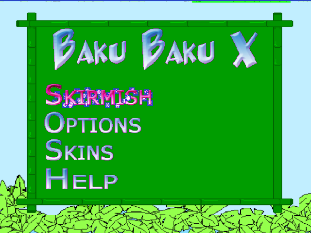

# Baku Baku X2 — decompilation

*Part of the [AfterShock decompilations](../../README.md).*

A readable C++ reconstruction of **Baku Baku X2** (SHiZNO / AfterShock,
February 2004), an original Xbox homebrew remake of Sega's Baku Baku Animal:
falling-block matching for 2 to 8 players (4 on pads), with skins loaded at
run time and custom soundtracks.

**Status: complete.** All 119 of the game's functions are in `src/`
(100% by `tools/progress.py`), the rebuild runs in xemu, and it plays frame
for frame like the original in the differential test (below).

<p align="center">
  
  
</p>

*Screenshots are of the rebuilt XBE running in [xemu](https://xemu.app).*

* The XBE was built with the Xbox XDK 5558 (every library's version, and
  4144 library functions match 5558 byte for byte, against 4056 for 5933
  and 2989 for 4361). Its own code is ~38 KB at 0x11000-0x1AB25; the rest
  is XDK library code (D3D, D3DX, DirectSound, the WMA decoder, DirectMusic,
  the C runtime). It is linked with `dmusic.lib` (`EXTRA_LIBS`).
* It shares the gamepad (`CInput`), the music player (`CMusicManager`, the
  XDK's BackgroundMusic sample) and the font with the other AfterShock games,
  in earlier versions (`../../tools/crossmatch.py pool --near 0.7`).
* `funcdiff.py -x`: 105 of 118 functions compile to the original's
  instructions, registers and order included; the rest differ in register
  allocation, instruction order or stack slots.

## The source

| File | What |
|------|------|
| `src/Game.h` | every class with the original's offsets (checked at compile time) and the globals |
| `src/Main.cpp` | `main()`, the device, the splash, the frame and its music box |
| `src/Game.cpp` | `CGame`: the match flow (countdown, play, result, next round), the pads, the layouts for 2-8 boards, garbage |
| `src/Board.cpp` | `CBoard`: the falling pair, gravity, matches (`Flood`), the computer players; `CEater` (the animals that eat), `CPiece`, `CCrumbs` and the lion that eats a lost board |
| `src/Menu.cpp` | the menus: main, setup, options, pause, skins, help |
| `src/Skins.cpp`, `src/Config.cpp` | the skins in `D:\skins` and `T:\baku2.cfg` |
| `src/Particles.cpp`, `Textures.cpp`, `Font.cpp`, `Sound.cpp`, `Input.cpp`, `MusicManager.cpp` | the rest |

Quirks are kept and commented, among them: the config file is read with
`%d` into `bool`s (the original saves and restores the global that
overflows into); skin files are never closed and the last line of a
`skin.cfg` is loaded twice; A on a player's control skips pad 1; free for all
garbage with no other board alive never ends; pad 1's player keeps resetting
the 75 ms input timer.

Some of the source's shape is there for the compiler, to give the
original's code: the frame helpers `SET_FRAME`, `SET_QUAD` and the menu's
`DRAW_QUAD` are macros (a global passed by reference is read back after
every store through a pointer, an inline function's arguments are worked out
before its body), while `CycleUp`/`CycleDown` take a reference (the original
reads the page's item back after each change). The shared `tools/xbox.mk`
gained `EXTRA_LIBS` and `EXTRA_CFLAGS`.

## Differential testing

`tools/difftest.py` runs the original and the rebuild side by side in
Unicorn from a RAM snapshot of the original in xemu, with the same pad
input, comparing globals, heap, every D3D call and the sound calls after
every frame (see `../starwars/README.md` for the script syntax):

```
../../tools/xemu_drive.py <xemu.toml> "35 ram:menu" <outdir>
tools/difftest.py run <outdir>/menu.ram "10 hold:A:9 20 hold:START:9 2000"   # an 8-player match
tools/difftest.py fuzz <outdir>/menu.ram 4000 3
```

The menus read the pad every 130 ms, so hold buttons for a few frames.
The CRT's x87 dispatch tables (`_OP_*jmptab`) hold code addresses, so the
test keeps our own rather than copying the original's.

## Building

See the [repository README](../../README.md#building). Put the release in
`original/` (the target is `default.xbe`, sha1
`18a91b1efb909027738142d438d714a11740ee54`, with `media/`, `skins/` and
`shizno.png` next to it); `make xiso` puts all of them on the disc.

## Legal

This is a reconstruction for study, preservation and modding. It doesn't
include the original XBE, its media or any part of the XDK. You need your
own copy of the game.
