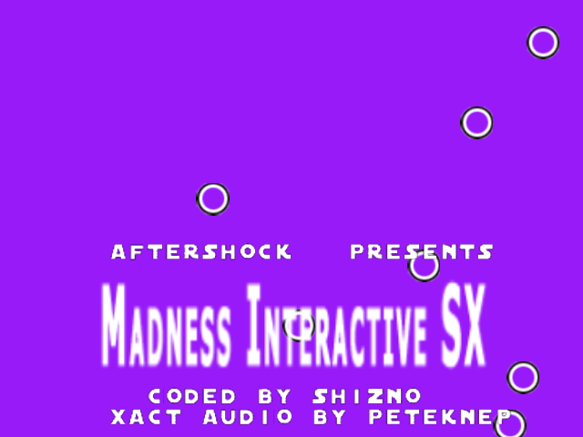
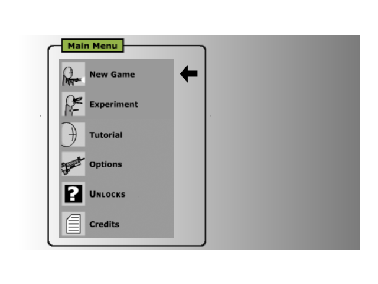
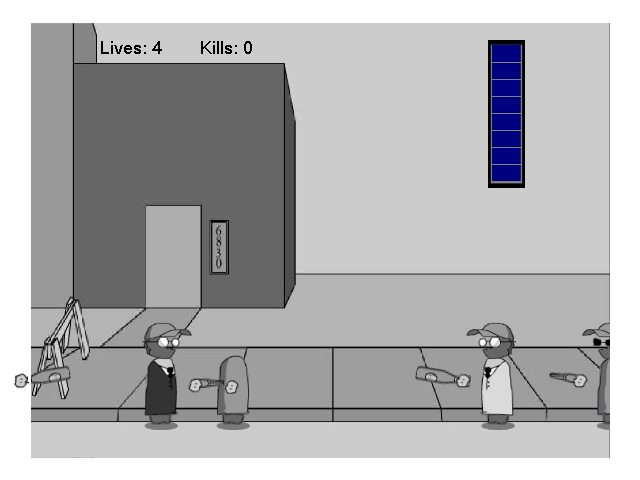

# Madness Interactive SX — decompilation

*Part of the [AfterShock decompilations](../../README.md).*

A readable C++ reconstruction of **Madness Interactive SX** (SHiZNO /
AfterShock, May 2005), an original Xbox homebrew side-scrolling shooter in
the style of Madness Combat: fourteen levels of story, fist fights, ten
weapons and a jetpack, bullet time, a character editor, unlocks, a free-play
Experiment mode and a Tutorial.

**It builds and runs.** The source compiles with the original toolchain
(Xbox XDK 5558, MSVC 7.1) into a `default.xbe` that plays like the
original, quirks included. You need your own copy of the original release:
its `media/` to play, and its `default.xbe` to build (see
[Text from the original](#text-from-the-original)).

<p align="center">
  
  
</p>
<p align="center">
  
  
</p>

*All screenshots are of the rebuilt XBE running in [xemu](https://xemu.app)
(the `XEMU=1` build, see below).*

## Status

* **Every function of the game (93 functions, ~91 KB of code) is
  reconstructed** in `src/`, named and commented. The rest of the XBE is XDK
  library code, matched byte for byte.
* **Behavior:** checked in xemu so far. Screenshots of the rebuild and the
  original through the intro, the menus, the story and the first level come
  out pixel-identical. Pool's frame-by-frame differential tests haven't been
  ported to this game yet.
* **Not byte-identical yet:** the functions are written to do the same thing,
  not to compile to the same instructions.

## Building

See the [repository README](../../README.md#building): with the XDK linked as
`xdk` at the top and the release in `original/`, run `make` here. The result
is `build/xbox/default.xbe`; `make xiso` puts it on a disc image with the
original's `media/`. The build also checks every class layout in `src/`
against the original's offsets.

The original game is **not** part of this repository. Put the release in
`original/` (the target is `default.xbe`, sha1
`854b2f143b19d42c318d67dbc3d86418b2b1f9d0`).

### xemu

The game sets up its camera with a near plane of exactly 0, which puts
everything it draws on the far plane. A real Xbox draws it; xemu clips all of
it, so in xemu the game (the original too) shows only its clear colors:
purple for the intro, white for the menus. With `XEMU=1`, the build uses a
near plane of 1.0 instead (`XEMU_FIX` in `InitDevice`), which changes depth
values only, not where anything lands on screen:

```
make XEMU=1 xiso             # build/xemu/MadnessInteractiveSX.iso
make XEMU=1 original-xiso    # build/xemu/Original.iso, patched the same way
```

`tools/xemu_patch.py` patches the original for this: the zero is a
`push edi`, so it jumps to a few spare bytes after `.text` that push 1.0.

### Text from the original

The credits, the story, the ending's dialogue, the Tutorial and the
Experiment's help text aren't in the repository. `tools/extract_data.py`
pulls them from `original/default.xbe` at build time into
`build/xbox/gen/` (`credits.inc`, `text.h`), and the source refers to them by
address (`TEXT_0009F9C8`). Short labels and format strings are inline.

## Modding notes

* **The media is checked.** At startup, `VerifyMedia` (`src/Crc32.cpp`)
  compares a CRC-32 of every head, level picture, menu image and most other
  textures with values built into the game, and shows "Media Error! Please
  verify installation!" forever on the first mismatch. To change one of
  those files, update its CRC in the tables there (or skip the check).
* Nearly all state lives in one global aggregate, `g_Game` (`CGame`, at
  0xA6128 in the original), used by free functions; its member order is the
  original declaration order. Characters are `SCharacter` (player 0 and the
  AI), weapons lying around or carried are `SItem`, and `SWeaponType` holds
  each weapon's textures and sizes.
* `main()` (`src/Main.cpp`) loads everything and then loops input, `Update`
  (`src/Update.cpp`) and `Render` (`src/Render.cpp`), with `g_Game.state`
  choosing between the splash, the intro, the menus, the story, the levels,
  the ending, Experiment and the Tutorial.
* Settings, unlocks and statistics are saved in `T:\xmadness.cfg`
  (`src/Config.cpp`).

## Shared with AfterShock Pool SX

`../../tools/crossmatch.py pool` finds nearly 50 functions with the same
instructions as AfterShock Pool SX: the gamepad (`CInput`, from the XDK
samples' `XBGAMEPAD`), the music player (`CMusicManager`, from the XDK's
BackgroundMusic sample), the font, the sound (XACT: `madness.xwb` and
`madness.xsb`, whose cue names are used here), the scrolling credits and file
loading. This game keeps its own copy of each, with its own additions
(rumble, the thumbstick clicks).

## Known quirks of the original

Kept as they are, and marked in the source:

* The settings loader reads each flag with `%d` into a one-byte `bool`, so
  every value spills into the next three bytes: the last unlock flag
  clobbers the cheat code's progress, and the music flag the lowest byte of
  the highest head-hit count (`src/Config.cpp`).
* The menu loads twelve pages into eleven slots; there is no `12.tga`, and
  the slot it overwrites is the music menu's, loaded right after.
* The AI's reaction time and the enemy spawn timer use `(rand() % 10) / 10`,
  integer division, so they're always the same.
* Hovering with the jetpack turns any horizontal speed into exactly 1
  (`vel.x / vel.x`), so it always drifts right.
* Experiment's "Spawn Random AI" picks a random weapon, then always gives a
  rifle.
* Head shots are checked against the shooter's head offset, not the target's.
* `glasses\1.tga` is loaded but never shown; the intro's credits are drawn
  twice a frame; the handgun ejects no shell.
* The Unlocks screen has a cheat: Down, Up, Up, Right, Left on the left stick
  unlocks everything. Finishing the Tutorial unlocks Hyper Mode.
* In the ending, the player's character becomes Lantus.

## Legal

This is a reconstruction for study, preservation and modding. It doesn't
include the original XBE, its media, its text or any part of the XDK. You
need your own copy of the game.
