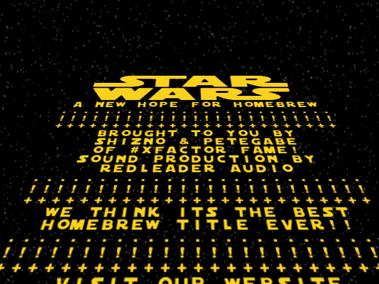
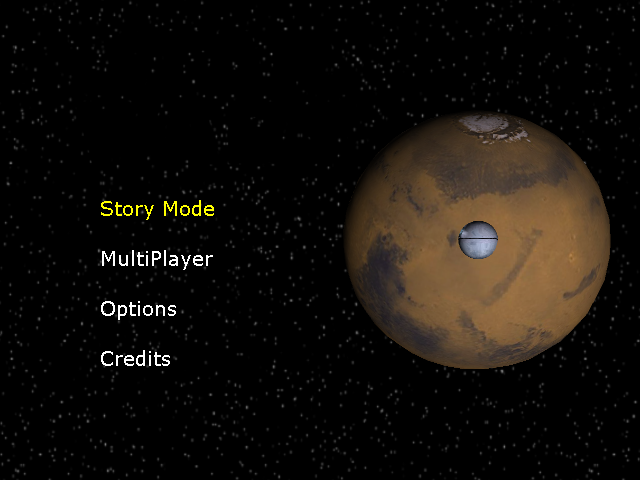
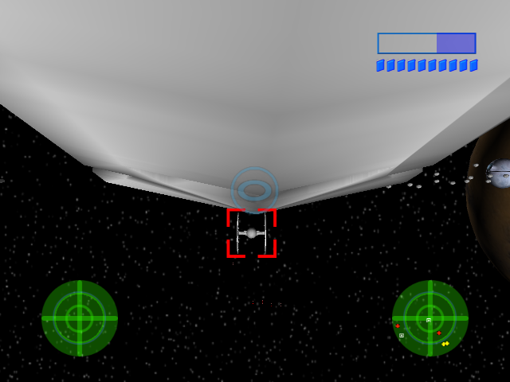

# Star Wars: A New Hope for Homebrew — decompilation

*Part of the [AfterShock decompilations](../../README.md).*

A readable C++ reconstruction of **Star Wars: A New Hope for Homebrew** (v1.3,
SHiZNO & PeteGabe / AfterShock, 2005), an original Xbox homebrew space
shooter: a story mode where an X-wing squadron fights TIEs, interceptors
and Star Destroyers, then flies the Death Star trench run with Vader on its
tail, and a split-screen deathmatch for up to eight ships (four players on
pads, the rest AI) as X-wings, A-wings, the Millennium Falcon, TIEs, Vader's
TIE or interceptors.

**It builds and runs.** The source compiles with the original toolchain
(Xbox XDK 5558, MSVC 7.1) into a `default.xbe` that plays like the original,
quirks included. You need your own copy of the original release: its
`media/`, `hud/` and `models/` to play, and its `default.xbe` to build (see
[Text from the original](#text-from-the-original)).

<p align="center">
  
  
</p>
<p align="center">
  
  
</p>

*All screenshots are of the rebuilt XBE running in [xemu](https://xemu.app).*

## Status

* **Every function of the game (238 functions, ~97 KB of code) is
  reconstructed** in `src/`, named and commented. The rest of the XBE is XDK
  library code, matched byte for byte.
* **Behavior:** checked frame by frame against the original with
  `tools/difftest.py` (below), function by function with
  `../../tools/funcdiff.py`, which compares the constants, struct offsets,
  compares and calls of each rebuilt function with the original's, and in
  xemu next to the original through the title, the menus, the briefing and
  the space battle.
* **Not byte-identical yet:** the functions are written to do the same thing,
  not to compile to the same instructions.

## Building

See the [repository README](../../README.md#building): with the XDK linked as
`xdk` at the top and the release in `original/`, run `make` here. The result
is `build/xbox/default.xbe`; `make xiso` puts it on a disc image with the
original's `media/`, `hud/` and `models/`. The build also checks every class
layout in `src/` against the original's offsets.

The original game is **not** part of this repository. Put the release in
`original/` (the target is `default.xbe`, sha1
`696473098a54fa3fca2db8016527f6f935c4a95b`).

### xemu

The game runs in xemu as it is; there is no `XEMU=1` build. Its text is drawn
by the CPU into the front buffer (XFONT), right before the next frame is
swapped in, so in xemu menu text sometimes doesn't show for a while. That
happens to the original too.

### Text from the original

The title's scrolling text isn't in the repository: `tools/extract_data.py`
pulls it from `original/default.xbe` at build time into
`build/xbox/gen/crawl.inc`.

## Differential testing

`tools/difftest.py` runs the original and the rebuild side by side in an x86
emulator (Unicorn), from the same whole-RAM snapshot of the original running
in xemu, with the same pad input, and compares after every frame the
globals, every heap page either build touched, every D3D call (matrices,
viewports, lights, vertex data, the text drawn) and every sound call:

```
../../tools/xemu_drive.py <xemu.toml> "22 A 2 A 1.5 hold:A:0.3 12 ram:battle" <outdir>
tools/difftest.py run <outdir>/battle.ram "600"              # 600 idle frames
tools/difftest.py run <outdir>/battle.ram "hold:RT:60 LX:1:30 START 20"
tools/difftest.py run <outdir>/battle.ram "set:g_Game+0x2178:i:11 2000"   # skip to the Death Star
tools/difftest.py fuzz <outdir>/battle.ram 3000 7            # random input, seed 7
```

The music player and the sound engine are logged, not run; files come from
`original/`, and `T:\` is a scratch folder per build. The shared part is
`../../tools/difftest_core.py`. The rebuild is linked with `/OPT:REF
/OPT:ICF` like the original, which also keeps its image below the
original's heap.

## Modding notes

* **The media is checked.** At startup, `CheckMedia` (`src/Main.cpp`)
  compares the MD5 of 42 files of the release (textures, models, fonts,
  sounds) with values built into the game, and shows "Invalid File Detected!"
  forever on the first mismatch. The title's text is checked the same way
  (`CIntro::Create`, which quits). To change one of those files, update its
  MD5 in the table (or skip the check).
* The game's state is `g_Game` (`CGame`, at 0xBDFE0 in the original); the
  meshes, the HUD, the radar and the sky are separate globals in
  `src/Main.cpp`. The ships share a base class, `CShip`, whose virtuals
  (`Move`, `Render`, `Hit`, `Reset`, the four control schemes and `Fire`)
  each ship class overrides; the linker merged identical ones (the TIE's and
  the interceptor's `Render` and `Move` are one function).
* `main()` loads everything and loops `FrameMove` and `RenderFrame`, with
  `g_Game.mode` (`MODE_*`) choosing between the title, the menus, the story's
  stages and multiplayer.
* Settings (inverted Y, vibration and the multiplayer setup) are saved in
  `T:\starwars.cfg` (`CMenu::SaveConfig`).

## Shared with the other games

`../../tools/crossmatch.py pool` and `crossmatch.py madness` find the engine
code the AfterShock games share: the gamepad (`CInput`), the music player
(`CMusicManager`), the font, the sound (XACT: `JayStarWars.xwb` and
`StarWarsBank.xsb`), MD5 and the meshes. This game keeps its own copy of
each, as it was built.

## Known quirks of the original

Kept as they are, and marked in the source:

* The TIEs', interceptors' and Vader's bolts are tested against the X-wing
  with the gun's number: gun k's bolts can only hit X-wing k.
* A TIE's reset zeroes its first gun's position instead of resetting it.
* The interceptors pick a target like the TIEs but always steer at the
  player.
* When the trench's end is placed, the segment recycled with it goes two
  lengths on instead of one, leaving a gap before the end.
* The battle's goal is 11 kills (31 on Hard), one more than the briefing
  says.
* Start on the difficulty page goes straight into the battle, without the
  briefing or the story's setup.
* The multiplayer radar starts its loop at the second ship, so nobody sees
  the first player and the others see themselves.
* The torpedo's animation frame is `(t / 800) * 7` in integers, so only
  frames 0 and 7 show.
* The settings loader reads the bools with `%d`, four bytes each, over the
  members after them.
* When a multiplayer AI's target has died, it steers by ship −1 for a frame.
* The glows' pulse loops 40 times but steps once a call; the asteroids' z is
  `rand() % 1`, always 0; twelve explosion frames are loaded into eight slots.

## Legal

This is a reconstruction for study, preservation and modding. It doesn't
include the original XBE, its media, its text or any part of the XDK. You
need your own copy of the game.
